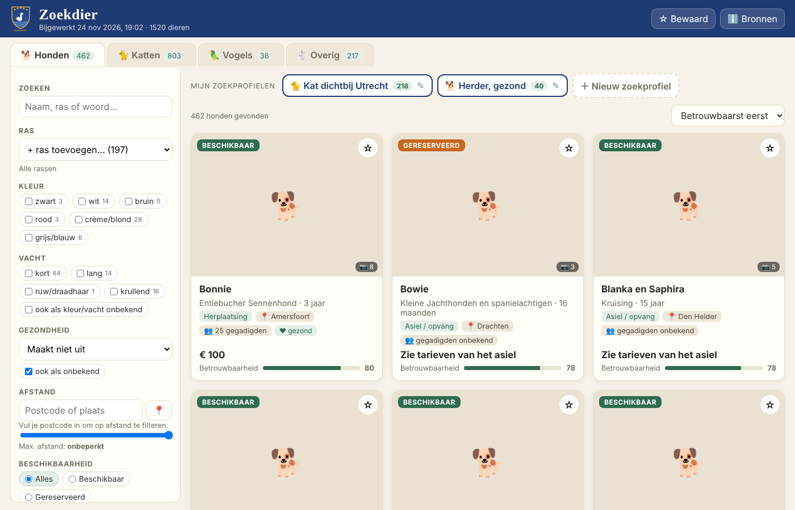
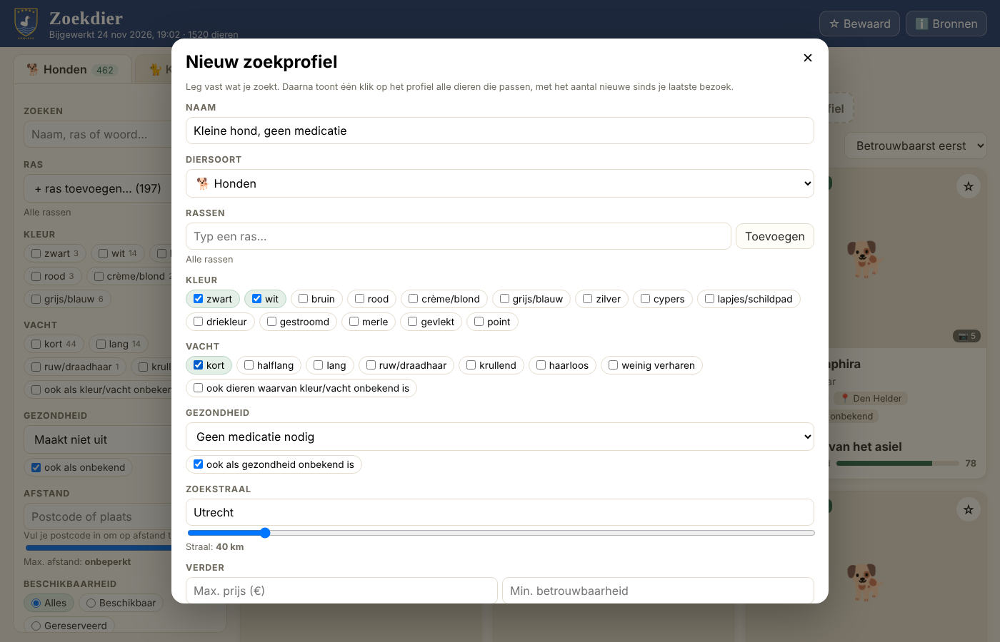
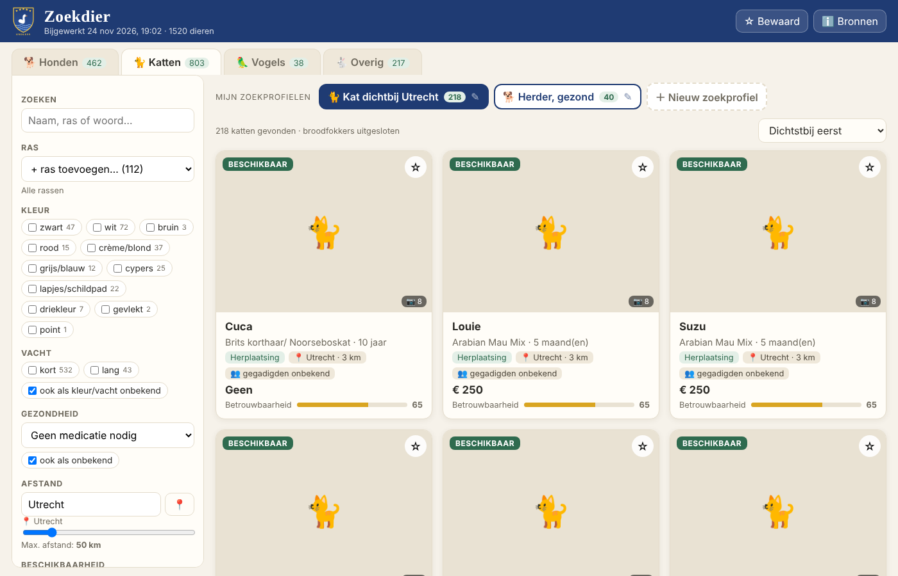
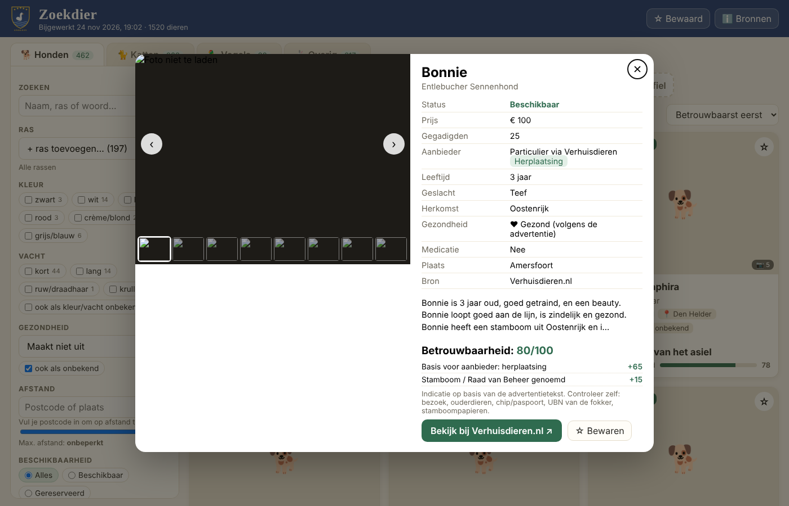
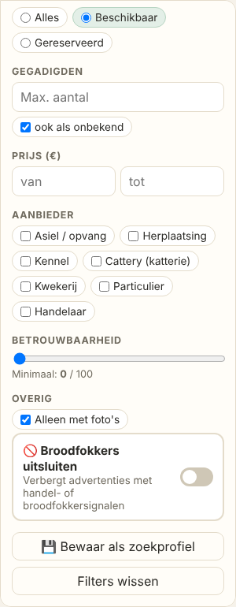
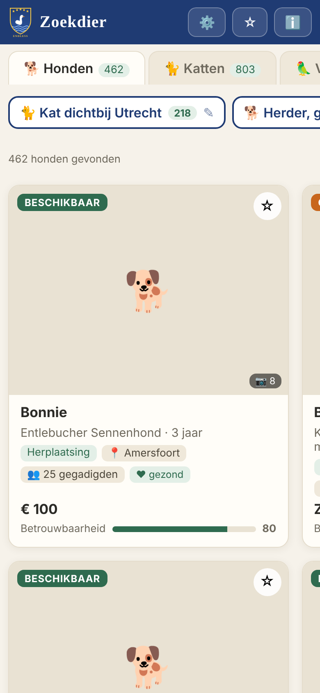

<p align="center"></p>

# 🐾 Zoekdier

**Zoekdier zoekt herplaatsings- en asieldieren op één plek: honden, katten, vogels en overige dieren.** Je filtert op ras, kleur, vacht, gezondheid en afstand vanaf je postcode. Elke aanbieder krijgt een betrouwbaarheidsscore, en met één knop verberg je advertenties van broodfokkers. Leg je wensen vast in een **zoekprofiel**, dan zie je met één klik alle dieren die passen, met hoeveel er nieuw zijn sinds je laatste bezoek.

👉 **Openen:** https://endless1977.github.io/Zoekdier/



## Functies

| | |
|---|---|
| **Tabs** | Honden · Katten · Vogels · Overig, met het aantal dieren per tab |
| **Zoekprofielen** | Leg ras(sen), kleur, vacht, gezondheid/medicatie, zoekstraal vanaf postcode, max. prijs en meer vast. Eén klik toont alle passende dieren, met een teller voor nieuwe dieren sinds de vorige keer. |
| **Filters** | Zoekwoord, meerdere rassen, kleur, vacht, gezondheid, afstand (postcode/plaats of 📍 je locatie), beschikbaar/gereserveerd, max. gegadigden, prijs, type aanbieder, minimale betrouwbaarheid, alleen met foto's |
| **Aanbieder** | Asiel · herplaatsing · **kennel** · **cattery (katterie)** · kwekerij · particulier · handelaar |
| **Betrouwbaarheid** | Score van 0 tot 100, met per punt de uitleg in het detailvenster |
| **🚫 Broodfokkers uitsluiten** | Verbergt advertenties met handel- of broodfokkersignalen |
| **Detailvenster** | Fotogalerij, prijs, gegadigden, kleur, vacht, gezondheid en medicatie, alle kenmerken van de bron en een link naar de advertentie |
| **Bewaren** | ☆ Dieren bewaren. Je zoekprofielen en filters blijven in je browser bewaard. |

### Zoekprofiel aanmaken
Klik op **＋ Nieuw zoekprofiel**, of stel de filters in en klik op **💾 Bewaar als zoekprofiel**.



### Eén klik: alle passende dieren
Het profiel toont het aantal treffers, en bij een volgend bezoek ook hoeveel er **nieuw** zijn.



### Detailvenster en betrouwbaarheid


<p>

&nbsp;&nbsp;

</p>

## Bronnen
| Bron | Hoe | Wat |
|---|---|---|
| [Verhuisdieren.nl](https://verhuisdieren.nl) | sitemap + profielpagina's | herplaatsing door particulieren (adoptie; oppasdieren worden overgeslagen) |
| [Ik zoek baas](https://ikzoekbaas.dierenbescherming.nl) (Dierenbescherming) | sitemap + profielpagina's | dieren uit alle aangesloten asielen |
| [Marktplaats](https://www.marktplaats.nl) | **officiële API** (sleutels nodig) | particulieren, fokkers, kennels, catteries |
| eigen bronnen | `scraper/bronnen.json` | extra asielen, kennels of catteries toevoegen zonder code |

Onder **ℹ️ Bronnen** in de app zie je hoeveel dieren elke bron bij de laatste run opleverde.

## Hoe het werkt
```
GitHub Action "Dieren ophalen" (elke 6 uur)
   → scraper/run.py  → data/dieren.json  →  index.html (GitHub Pages)
GitHub Action "Schermafbeeldingen" (na elke wijziging van de app + wekelijks)
   → tools/screenshots.py → docs/screenshots/*.png
```
| Bestand | Taak |
|---|---|
| `index.html` | de hele app (één bestand, geen build nodig) |
| `scraper/adapters/*.py` | uitlezers per bron |
| `scraper/kenmerken.py` | kleur, vacht, gezondheid en medicatie uit de kenmerken en de tekst. Houdt rekening met ontkenningen zoals "FIV negatief" of "geen medicatie". |
| `scraper/scoring.py` | betrouwbaarheid, broodfokkersignalen, type aanbieder |
| `scraper/rassen.py` | ras afleiden uit de titel als een bron geen rasveld heeft |
| `tests/test_parsers.py` | offline tests: `python tests/test_parsers.py` |

## Betrouwbaarheid (0–100)
Startscore per aanbieder: asiel 75, herplaatsing 65, kennel/cattery 55, kwekerij 50, particulier 45, handelaar 30.
- **Pluspunten:** stamboom (Raad van Beheer/NHSB, FIFe/Felikat), rasvereniging, UBN, chip/paspoort, gezondheidsonderzoeken van de ouderdieren, ouderdieren te zien, vaccinaties, geringde vogels
- **Broodfokkersignalen:** "direct meenemen", bezorgen, overdracht op een parkeerplaats, meerdere rassen of nesten, importpups, te jong (hond < 7 wk, kat < 12 wk), vouwoorkat (verboden sinds 2026), geen papieren, vooruitbetalen, prijs ver onder de mediaan van het ras, dezelfde aanbieder met 3 of meer rassen

Vanaf 25 signaalpunten, of bij een handelaar, krijgt een advertentie het label **broodfokker?**. Het blijft een indicatie: ga altijd zelf kijken.

## Instellen (eenmalig)
1. **Settings → Pages:** *Deploy from a branch*, branch `main`, map `/ (root)`
2. **Settings → Actions → General → Workflow permissions:** *Read and write*
3. **Actions → Dieren ophalen → Run workflow**

### Marktplaats koppelen (optioneel)
1. Vraag bij Marktplaats API-toegang aan (een *client_credentials*-client).
2. Zet de sleutels bij **Settings → Secrets and variables → Actions** als `MP_CLIENT_ID` en `MP_CLIENT_SECRET`.
3. Start de workflow opnieuw. Zonder sleutels slaat de scraper Marktplaats over.

### Lokaal draaien
```
pip install -r requirements.txt
python scraper/run.py          # gegevens ophalen
python -m http.server          # app op http://localhost:8000
python tools/screenshots.py    # schermafbeeldingen (pip install playwright)
```

## Beperkingen
- **Gegadigden:** de meeste sites tonen dit niet. Dan staat er "onbekend", en met een vinkje kies je of die dieren meetellen.
- **Kleur, vacht en gezondheid** worden uit de advertentietekst afgeleid. Staat er niets over in de advertentie, dan is het "onbekend". Met een vinkje kies je of die dieren meetellen.
- **Marktplaats:** de API-documentatie beschrijft niet alle velden (plaats, foto's). De eerste run met sleutels laat zien of die goed uitgelezen worden.

## Wijzigingen
| Datum | Wijziging |
|---|---|
| 2026-11-24 | **Zoekprofielen** (één klik, teller voor nieuwe dieren), filters op **kleur, vacht, gezondheid/medicatie** en meerdere rassen, alle bronkenmerken in het detailvenster, schermafbeeldingen in de README met automatische update |
| 2026-11-23 | Marktplaats via de officiële API, Ik zoek baas en Verhuisdieren via de sitemap |
| 2026-11-23 | Eerste versie: tabs, filters, betrouwbaarheid, broodfokkerknop, GitHub Action |
